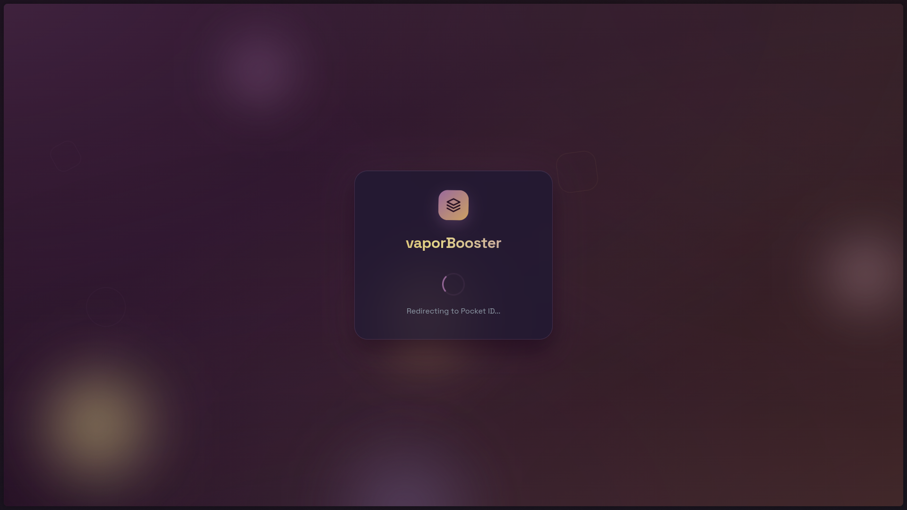
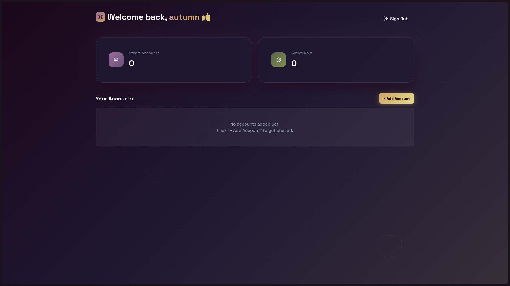
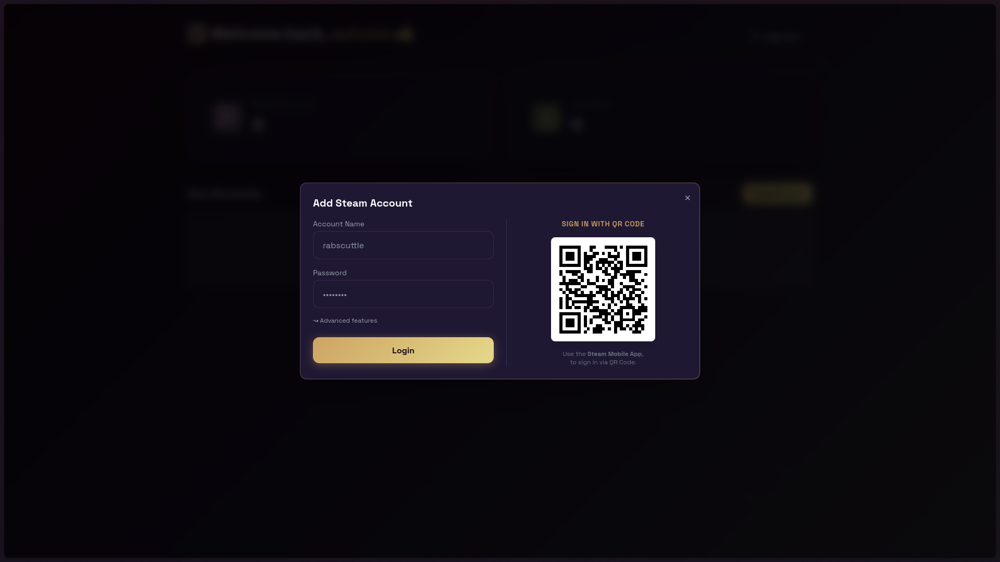
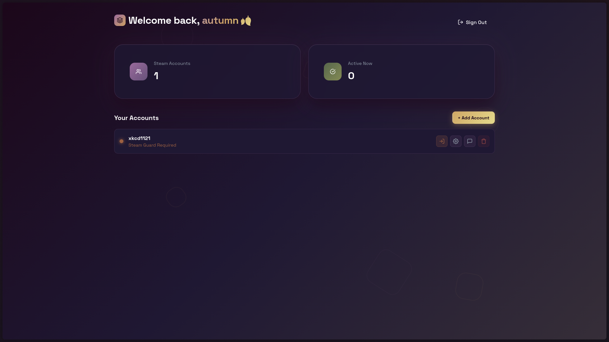
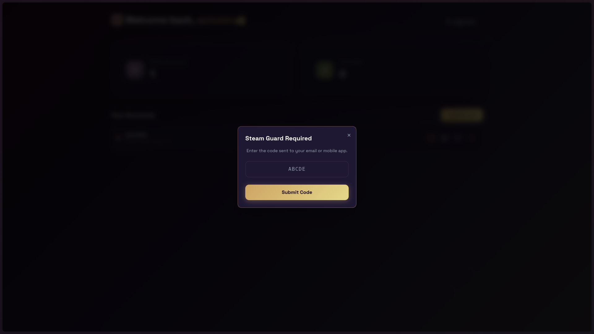
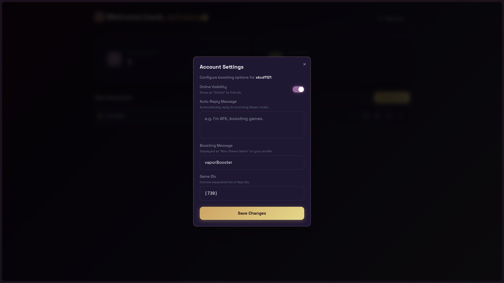
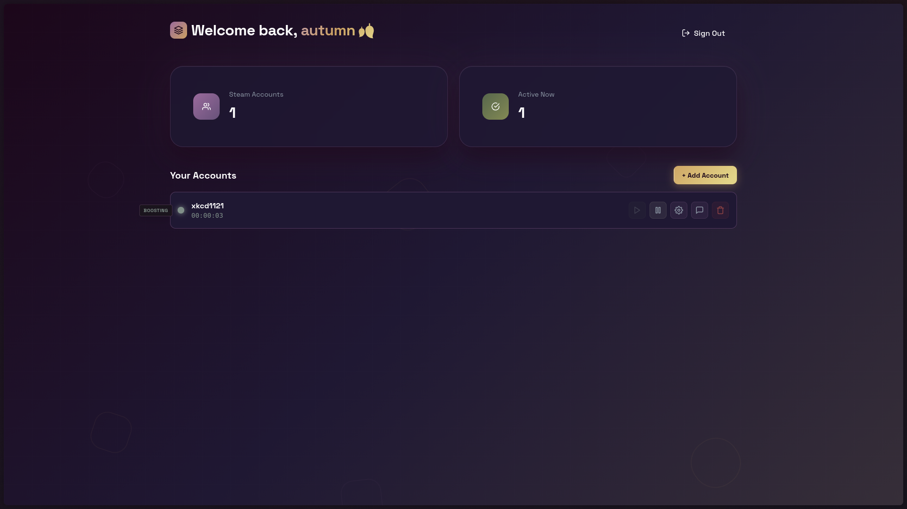
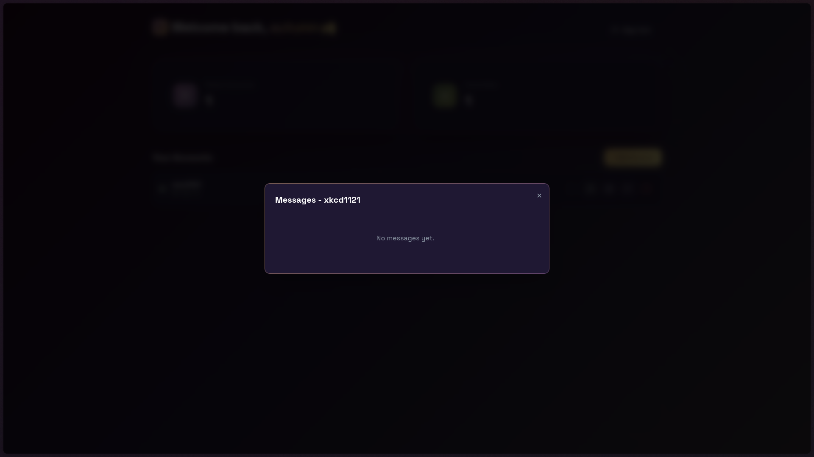
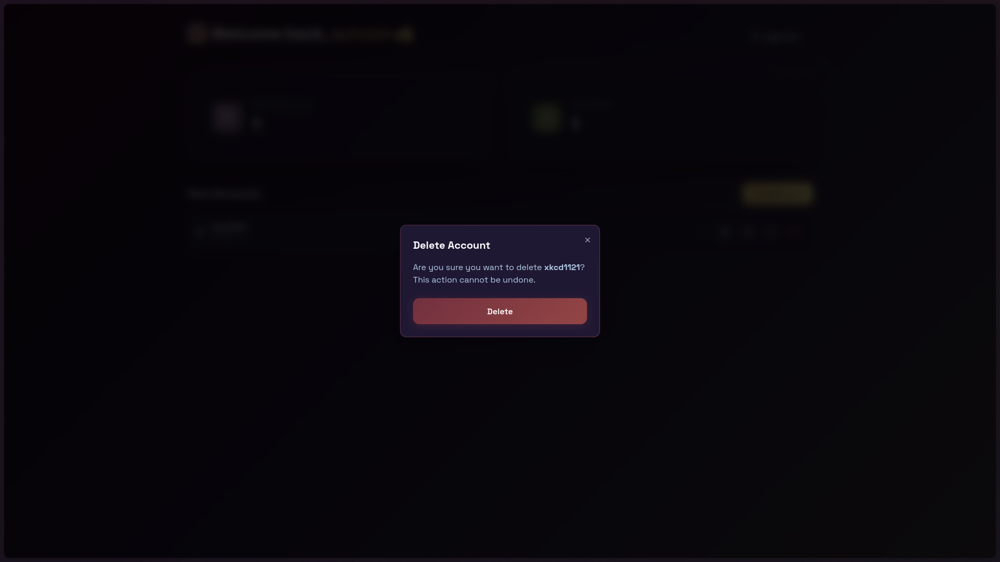

<div align="center">


# vaporBooster

Version **v0.0.5** — HTTPS-only. See [release changes](CHANGELOG.md).

### Simple, fast and reliable hour booster for the Steam platform.

[](https://www.docker.com/)
[](https://deno.land/)
[](https://svelte.dev/)
[](https://tailwindcss.com/)

</div>

---

## Editors and contributors

- **[valnssh/vaporBooster](https://github.com/valnssh/vaporBooster)** — original project.
- **Codex (OpenAI)** — AI coding assistant used to prepare this fork's security
  review and hardening, HTTPS configuration, Steam integration fixes and regression tests.

---

## Screenshots

<div align="center">
  
  
  
  
  
  
  
  
  
</div>

---

## Deploy

For Debian 13, see the [Russian deployment guide](DEPLOY_DEBIAN13.ru.md).
Application data now requires PostgreSQL. Existing SQLite installations must follow
the [verified migration guide](MIGRATE_POSTGRESQL.ru.md) before starting this version.

For a complete installation with Keycloak, PostgreSQL and a reverse proxy on two
HTTPS domains, use the [full-stack installation guide](DEPLOY_FULL_STACK.ru.md).
It provisions the OIDC client and first panel user automatically, and supports
direct Steam sign-in through a private SteamID allowlist.

### 1. Configure environment variables

Copy the example file and set the required variables:

```bash
cp example.env .env
```

Generate a secure 32+ character secret for `BETTER_AUTH_SECRET`:

```bash
openssl rand -base64 32
```

Edit the `.env` file and paste the generated value:

```env
BETTER_AUTH_SECRET=<your_generated_secret>
```

Replace `hours.example.com` in both `BETTER_AUTH_URL` and `ORIGIN` with your own
HTTPS origin. Provide a valid certificate chain and private key using
`TLS_CERT_FILE`/`TLS_KEY_FILE`. For Compose, place them in `certs/fullchain.pem`
and `certs/privkey.pem` with read permissions for the container user; follow the
Debian guide for ownership. Certificates and private keys are excluded from Git
and image builds. Missing or invalid TLS credentials stop startup.

### 2. Start with Docker Compose

Set `DATABASE_URL` to a dedicated PostgreSQL database and place its trusted CA
certificate at `certs/database-ca.pem` for standalone Compose. TLS verification
is mandatory; URL query parameters cannot override it. The full-stack installer
creates both databases, restricted roles and private TLS settings automatically.

Configure the OIDC variables below before starting. Authentication is required by default.
For a trusted local-only instance without OIDC, explicitly set `ALLOW_ANONYMOUS=true`.
Partial OIDC configuration is rejected rather than falling back to anonymous access.

```bash
docker compose up -d
```

### 3. Access the application

The application is available at **https://YOUR-DOMAIN** using the configured certificate.

Compose publishes only HTTPS port 443 and binds to `127.0.0.1` by default.
For public access, configure OIDC and explicitly set `HTTPS_BIND_IP=0.0.0.0`.
In the standalone Compose file Deno serves TLS directly. The complete stack uses
Nginx with HTTP-to-HTTPS redirects and supplied certificates. Data lives in a
dedicated PostgreSQL database; the old `vaporbooster-data` SQLite volume is kept
read-only for migration/recovery. No database, backup or `.env` is copied into images.

---

## Authentication

By default, the server requires OIDC or explicitly configured Steam panel login. Anonymous operation must
be explicitly enabled and is intended only for a trusted local instance.

### Configure an OIDC provider

Configure an OpenID Connect provider by adding the following variables to your `.env`:

```env
OIDC_PROVIDER_NAME=My Provider
OIDC_PROVIDER_ID=my-provider
OIDC_CLIENT_ID=your_client_id
OIDC_CLIENT_SECRET=your_client_secret
OIDC_DISCOVERY_URL=https://your-provider/.well-known/openid-configuration
```

> [!NOTE]
> `OIDC_PROVIDER_NAME` is optional. The other four OIDC variables are required together.
> With all OIDC variables absent, `ALLOW_ANONYMOUS=true` explicitly permits shared local access.
> Never expose that mode to untrusted clients.

The updated Better Auth uses the standard social-provider callback:
`<BETTER_AUTH_URL>/api/auth/callback/<OIDC_PROVIDER_ID>`. Register this URI with
your identity provider when upgrading from the old generic-OAuth endpoint.

### Steam panel login

Set `STEAM_LOGIN_ENABLED=true` and a comma-separated `STEAM_ALLOWED_IDS` allowlist
in your private environment. The login page then offers Steam OpenID 2.0 alongside
OIDC. Steam verifies ownership on its own HTTPS website; no Steam password is
requested by the panel login. This does not connect an account for boosting.
After signing in through Keycloak, use **Link Steam login** in the dashboard to
make both login methods open the same profile. A separate first Steam login creates
a separate profile; accounts are never merged by a guessed email address.

## Upgrading existing data

Stop the old instance and back up its database before upgrading. Keep the same
strong `BETTER_AUTH_SECRET`: existing refresh tokens still need the original key.
Old token rows remain readable, while new tokens use versioned encryption.
All legacy plaintext Steam Guard seeds, including idle accounts, are encrypted
during initialization. Old database backups and SQLite pages may still contain
previous plaintext; this migration is not secure erasure of historical copies.

Use the [SQLite → PostgreSQL migration guide](MIGRATE_POSTGRESQL.ru.md).
The importer preserves every supported table, verifies row contents and sequence
values, and refuses a nonempty target or a duplicate import. It never deletes
history. Keep the source backup and original encryption key. An existing default
`sqlite.db` blocks runtime startup until the import has been verified; for a custom
filename set `LEGACY_SQLITE_FILE` to its runtime path.

## Security changes and checks

- Account operations share an ownership check, and page data excludes authentication secrets.
- Steam account names are unique within each owner's namespace, so another user's
  failed login cannot reserve or reveal an account name. Shared local accounts have
  their own uniqueness constraint. The upgrade migration preserves existing rows.
- Confirmation messages render as text. QR sessions have a captured owner, expiry,
  cancellation and bounded capacity; successful results can be consumed once.
- No Google Fonts or SteamDB requests are made. Better Auth telemetry is explicitly disabled.
- Steam chat text is stored for the dashboard but is not printed to process logs.
- Steam lifecycle logs use fixed messages without account names, account IDs or Guard email domains.
- Docker runs without root or extra capabilities, with a read-only root filesystem,
  a separate data volume and restricted Deno filesystem/process permissions.
- Production, development and preview require HTTPS. Sessions use Secure cookies,
  and HTTPS responses include HSTS. There is no HTTP fallback.
- Steam account logins use TLS WebSockets with local server filtering, preventing
  selection of the raw TCP transport. Passwords, Guard codes and tokens travel
  through this encrypted connection; stored Steam tokens and seeds use AES-256-GCM.
- Dependency versions and image digests are pinned. Outbound networking is still
  needed by Steam and the configured identity/database services; this is not a network allowlist.

Use Node 24 to run `pnpm test`, `pnpm check`, `pnpm lint`, and `pnpm build`.
Use the pinned pnpm 10.10.0 so the patches in `package.json` are applied.
SvelteKit 3.1.1 configuration lives in `vite.config.ts`; private runtime variables
are declared in `src/env.ts`. The pinned Deno adapter includes a compatibility
patch for SvelteKit 3 until upstream supports its builder API. Keep this patch
when installing or rebuilding the service.
TLS tests require OpenSSL on PATH, or `OPENSSL_BINARY` pointing to its executable.
Start the disposable TLS PostgreSQL instance before integration tests:

```bash
sh tests/start-postgres.sh
. .private/postgres-test/env
pnpm test
pnpm check && pnpm lint && pnpm build
pnpm test:runtime
docker rm -f -v hoursbooster-postgres-test
```

Each test suite gets a separate PostgreSQL database; the test helper refuses
admin URLs whose database is not named `hoursbooster_test`. SQLite is used only
by migration fixtures through Node's built-in `node:sqlite`, never by the running
application. Steam sessions are synthetic, without real account credentials. See `SECURITY_CHANGES.ru.md` for the Russian
change summary and deployment limitations.

Steam integration and lifecycle checks are documented in
[`STEAM_API_REVIEW.ru.md`](STEAM_API_REVIEW.ru.md). This includes the live QR-start
check and the account-authentication steps that still require manual verification.

After `pnpm build`, use `pnpm test:runtime` with Deno on PATH (or `DENO_BINARY`
pointing to its executable). This starts its own temporary server/database and
checks the page, linked styles/scripts, content types and rejected private paths.
Set `LIVE_STEAM=1` to also check QR start/poll/cancel against Steam without signing
in. The test never stops an existing instance. Windows static paths are normalized
before the adapter parses them so CSS and JavaScript load correctly.

---
